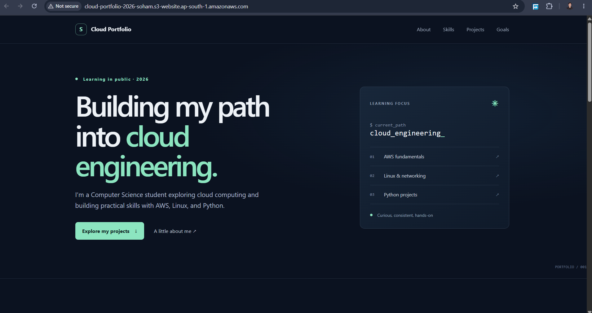
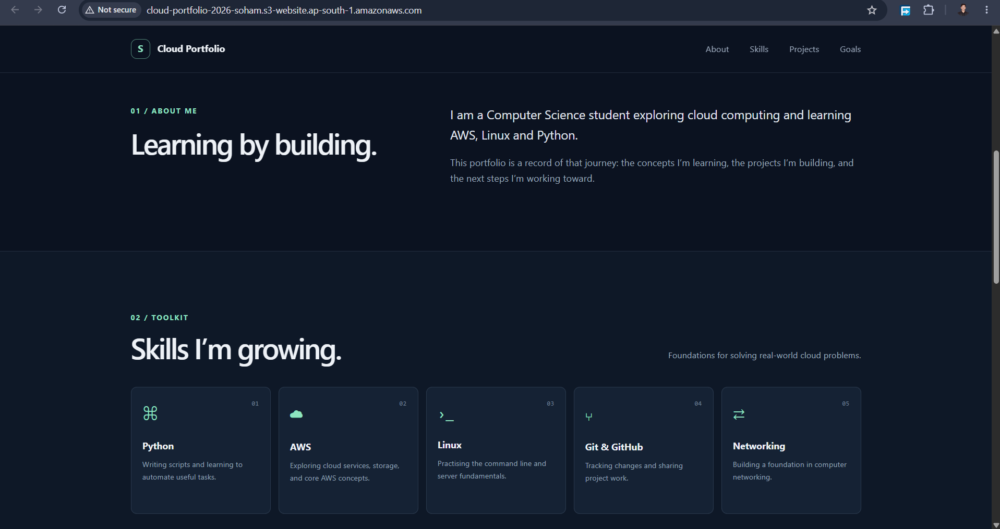
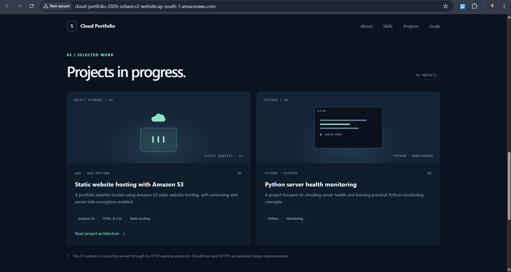

# AWS S3 Static Website Hosting

## Project Overview

This project demonstrates how to host a static website using Amazon Simple Storage Service (Amazon S3).

The website is built using HTML and CSS and deployed on AWS S3 static website hosting.

## AWS Services Used

- Amazon S3
- AWS Identity and Access Management (IAM)
- S3 Server-Side Encryption (SSE-S3)

## Project Features

- Static website hosting
- S3 bucket versioning
- Server-side encryption
- Bucket policy-based public read access
- Custom error page
- Website deployment and testing

## Architecture

A visitor accesses the website through the S3 static website endpoint. Amazon S3 serves the uploaded HTML, CSS and error page files.

## Website

**S3 Website Endpoint:**

## Live Portfolio

[View My New Portfolio](http://cloud-portfolio-2026-soham.s3-website.ap-south-1.amazonaws.com)
## Project Documentation

For detailed implementation steps, architecture and configuration:

[View Architecture Documentation](documentation/architecture.md)

## Key Learnings

- AWS S3 bucket configuration
- Object storage fundamentals
- IAM and bucket policies
- S3 versioning and recovery
- Server-side encryption
- Static website deployment
- Basic cloud security and cost considerations

## Future Improvements

- CloudFront integration for HTTPS and caching
- Private S3 bucket with Origin Access Control (OAC)
- Custom domain configuration
- Infrastructure automation using Terraform

## Website Screenshots

### Homepage

### About and Skills

### Projects
