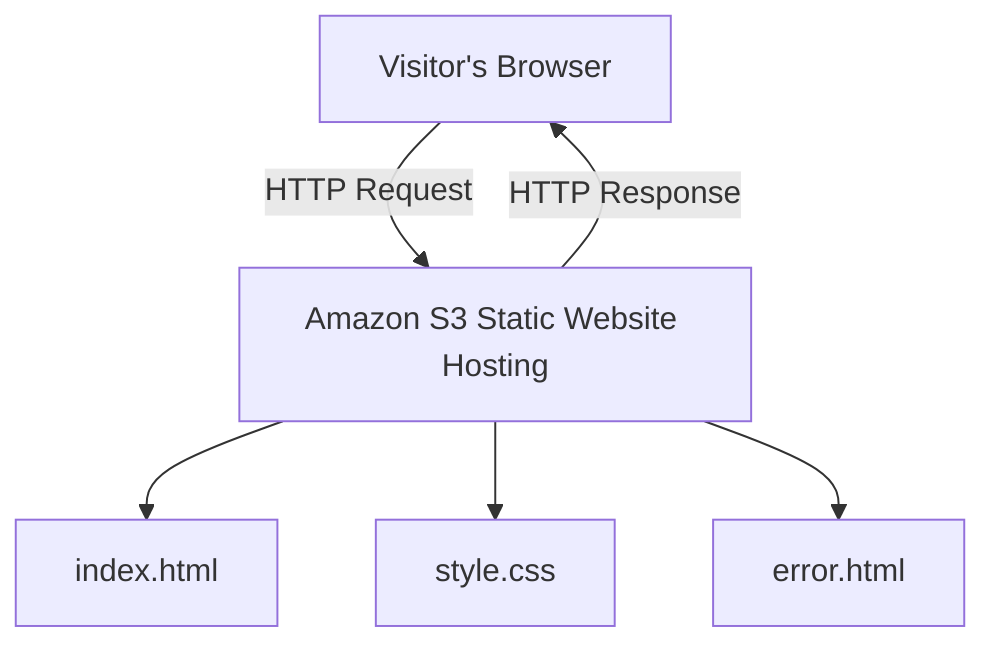

```text
cloud-portfolio/
├── README.md
├── documentation/
│   └── architecture.md
└── website/
    ├── index.html
    ├── style.css
    └── error.html
```


## Architecture Overview

The project uses Amazon S3 to host a static website.

- **Amazon S3:** Stores and serves website files.
- **index.html:** Main webpage.
- **style.css:** Controls the website's appearance.
- **error.html:** Custom error page.

Visitors access the website using the S3 static website endpoint.


## Architecture Diagram


## AWS Configuration Details

### 1. S3 Bucket

- Bucket name: `cloud-portfolio-2026-soham`
- AWS Region: Asia Pacific (Mumbai)
- Region code: `ap-south-1`
- Bucket type: General purpose

### 2. Security Configuration

- Object Ownership: ACLs disabled
- Encryption: SSE-S3
- Versioning: Enabled
- Static website hosting: Enabled

### 3. Website Hosting

- Index document: `index.html`
- Error document: `error.html`
- Website endpoint: HTTP

### 4. Public Access Configuration

- Block Public ACLs: Enabled
- Ignore Public ACLs: Enabled
- Block Public Bucket Policies: Disabled
- Restrict Public Buckets: Disabled
- Bucket policy: Public read access using `s3:GetObject`

### 5. Website Files

- `index.html`: Website structure and content.
- `style.css`: Website styling.
- `error.html`: Custom error page.


## Request Flow and Security

### 1. How a Website Request Works

1. A visitor opens the S3 static website endpoint in a browser.
2. The browser sends an HTTP request to Amazon S3.
3. S3 receives the request and checks the bucket permissions.
4. The bucket policy allows public `s3:GetObject` access.
5. S3 retrieves the requested website object.
6. The browser receives the response and displays the webpage.

### 2. Bucket Policy

The bucket uses a resource-based bucket policy to allow public read access.

- Principal: `*`
- Action: `s3:GetObject`
- Resource: Objects inside the bucket.

This allows visitors to retrieve website files without AWS credentials.

The policy does not grant visitors permission to upload or delete objects.

### 3. Versioning and Recovery

S3 Versioning is enabled on the bucket.

Benefits:

- Maintains multiple versions of an object.
- Preserves older versions when an object is overwritten.
- Allows recovery of previous versions.
- Helps protect against accidental changes or deletion.

A normal delete creates a delete marker when versioning is enabled. Previous versions remain available until permanently deleted.

### 4. Encryption

The bucket uses Server-Side Encryption with Amazon S3 managed keys (SSE-S3).

- Objects are encrypted at rest.
- S3 manages the encryption keys.
- Authorized retrieval automatically decrypts the objects.

### 5. Security Limitations

- The S3 static website endpoint supports HTTP, not HTTPS.
- Website objects are publicly readable under the current bucket policy.
- The project does not currently include a backend or database.
- CloudFront with Origin Access Control is a planned improvement, not yet implemented.


## Implementation Process

### Step 1: Create an S3 Bucket

1. Open the AWS Management Console.
2. Navigate to Amazon S3.
3. Create a general-purpose bucket.
4. Select the Mumbai Region (`ap-south-1`).
5. Configure Object Ownership with ACLs disabled.
6. Enable bucket versioning.
7. Enable default encryption using SSE-S3.

### Step 2: Configure Static Website Hosting

1. Open the bucket's Properties tab.
2. Find Static website hosting.
3. Enable static website hosting.
4. Set `index.html` as the index document.
5. Set `error.html` as the error document.
6. Save the configuration.

### Step 3: Configure Public Access

1. Review Block Public Access settings.
2. Configure the bucket to permit the intended public bucket policy.
3. Create a bucket policy allowing `s3:GetObject` on website objects.
4. Save the policy.

### Step 4: Upload Website Files

1. Prepare `index.html`, `style.css`, and `error.html` locally.
2. Open the S3 bucket's Objects tab.
3. Upload the website files to the bucket root.
4. Verify that all uploaded objects are visible.

### Step 5: Test the Website

1. Open the bucket's Properties tab.
2. Find the Static website hosting section.
3. Copy the website endpoint.
4. Open the endpoint in a browser.
5. Verify that the webpage and CSS styling load correctly.


## Troubleshooting

### 1. Website returns 403 Forbidden

Possible causes:
- Missing or incorrect `s3:GetObject` permission.
- Block Public Access settings preventing the public bucket policy.
- An explicit Deny in an applicable policy.

### 2. Website returns 404 Not Found

Possible causes:
- `index.html` is missing or incorrectly named.
- The requested object does not exist.
- The object was uploaded to the wrong location.

### 3. CSS is not loading

Possible causes:
- Incorrect CSS file path in `index.html`.
- Filename case mismatch.
- CSS file was not uploaded to the bucket.

### 4. Old website content appears

Possible causes:
- Browser cache.
- Incorrect object version uploaded.

Verify the current object version and refresh the browser.

## Cost Considerations

- S3 storage charges depend on the amount of data stored.
- Requests to retrieve objects may incur request charges.
- Data transferred to visitors may incur data transfer charges.
- Versioning can increase storage costs because older object versions remain stored.
- Lifecycle policies can help manage older versions and storage costs.

Always check current AWS pricing before deploying resources.

## Future Improvements

- Configure CloudFront for HTTPS delivery and content caching.
- Use Origin Access Control (OAC) with a private S3 bucket.
- Add a custom domain name.
- Improve website design and responsiveness.
- Explore infrastructure automation using Terraform.


## Project Documentation

Detailed project documentation is available here:

- [Architecture and AWS Configuration](documentation/architecture.md)

## Key Learnings

Through this project, I learned:

- Amazon S3 bucket creation and configuration.
- Static website hosting using HTML and CSS.
- S3 bucket policies and public access management.
- IAM and resource-based permissions.
- S3 Versioning and object recovery.
- Server-side encryption using SSE-S3.
- AWS website hosting troubleshooting.
- Basic AWS cost considerations.
